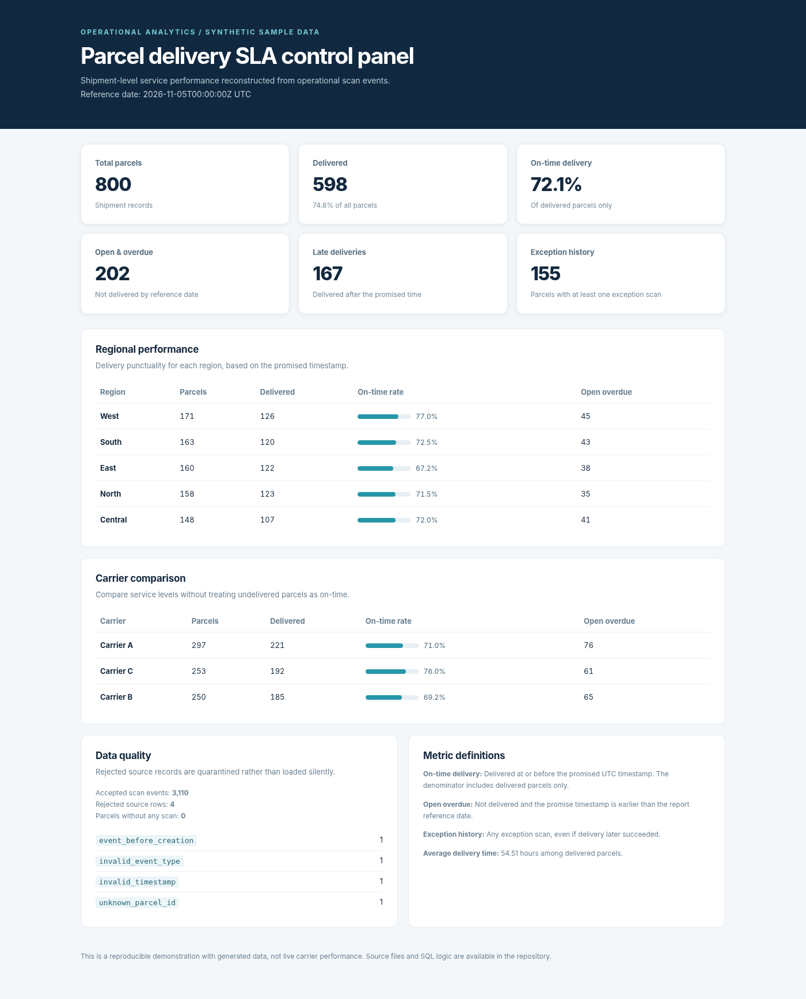
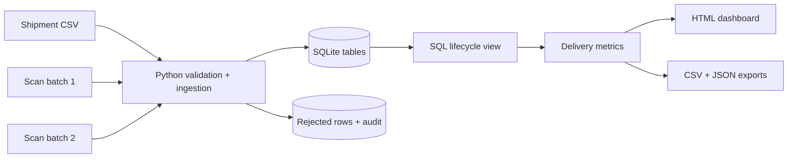

# Parcel Delivery SLA Analytics Pipeline

**Python · SQL · SQLite · Data Quality · GitHub Actions**

Parcel tracking looks straightforward until scans arrive late, events are repeated, or the source files contain bad records. I wanted to explore how those problems affect delivery reporting, so this project uses a small batch pipeline to turn shipment and scan data into a reliable operational view.

The pipeline reads CSV files, validates incoming records, loads them into SQLite, and uses SQL to reconstruct each parcel's delivery history. It then produces a browser-based dashboard and a few exports that could support an operations team.

All data in this repository is **synthetic**. The carrier names and results are fictional, not performance figures from a real logistics company.



[View example dashboard](examples/dashboard.html) · [Architecture](docs/architecture.md) · [Data dictionary](docs/data-dictionary.md) · [SQL queries](sql/analysis_queries.sql)

## The questions I wanted to answer

- What share of completed deliveries arrived before the promised deadline?
- Which carriers and regions have the most parcels still open and overdue?
- How can the pipeline handle duplicate scans and events that arrive out of order?
- What happens to invalid source records, and can I trace the reason they were rejected?

## Sample output

Running the included demo data produces these results:

| Metric | Result |
| :--- | ---: |
| Parcels | 800 |
| Delivered | 598 |
| Delivered on time | 431 |
| On-time rate (delivered parcels only) | 72.1% |
| Open and overdue | 202 |
| Parcels with exception history | 155 |
| Accepted scan events | 3,110 |
| Rejected source rows | 4 |

These results are reproducible for the checked-in example data and the fixed report reference time of `2026-11-05T00:00:00Z`. The on-time rate uses **delivered parcels**, not all created shipments, as its denominator.

The HTML report also includes regional and carrier breakdowns, data-quality counts, and descriptions of the KPI definitions.

## How it works



The pipeline has three main stages:

1. **Ingest:** Load shipment records first, then the two batches of scan events. Validate IDs, timestamps, and allowed event types. Keep rejected records separately with a reason.
2. **Transform:** Use a SQL window function to find each parcel's latest scan by **event timestamp** rather than the order in which files were processed. Identify deliveries and exception history.
3. **Report:** Calculate SLA measures by region and carrier, then export an HTML dashboard, CSV tables, and JSON summaries.

### A few engineering decisions

**Idempotent ingestion.** A repeated event ID with the same values is skipped. An event ID reused with different values is rejected rather than silently overwriting a previous scan. This means rerunning a batch doesn't inflate the counts.

**Event time vs. arrival time.** Some scan events appear in the second file even though they happened earlier than events in the first. Ordering by the timestamp of the scan avoids misreporting a parcel's latest state.

**Quarantine instead of silent deletion.** Rows with invalid timestamps, event types, or parcel IDs are recorded in a rejection table with their original values and the reason for failure.

**Clear metric definitions.** A parcel that hasn't been delivered shouldn't automatically be counted as a late delivery. I report undelivered overdue parcels separately.

More detail: [system design](docs/architecture.md).

## Run the project

You need **Python 3.11 or later**. There are no third-party Python dependencies, paid services, or API credentials.

From the root of the repository:

```bash
python run.py demo
```

This command loads both sample scan batches and writes the outputs to `build/reports/`:

| File | What it's for |
| --- | --- |
| `dashboard.html` | Standalone browser report |
| `kpis.json` | Headline delivery metrics |
| `region_performance.csv` | Results by region |
| `carrier_performance.csv` | Results by carrier |
| `parcel_lifecycle.csv` | One record per parcel |
| `data_quality.json` | Rejection totals and reasons |

Open `build/reports/dashboard.html` in a browser to see the result.

### Try incremental loading

Instead of running everything at once, you can process the two scan batches separately:

```bash
python run.py ingest --db build/incremental.sqlite --batch first
python run.py report --db build/incremental.sqlite --out build/first_report

python run.py ingest --db build/incremental.sqlite --batch second
python run.py report --db build/incremental.sqlite --out build/final_report
```

The second batch contains more deliveries, some older events arriving late, eight repeated event IDs, and four intentionally invalid rows. Run the second ingestion command again: the accepted event count should remain unchanged.

You can also generate a different synthetic dataset:

```bash
python run.py seed --out build/custom_source --count 1200 --seed 2026
python run.py demo --data-dir build/custom_source --db build/custom.sqlite --out build/custom_report
```

## Tests and CI

Run the tests locally:

```bash
python run.py test
```

The 11 regression tests cover duplicate ingestion, conflicting event IDs, invalid timestamps, late-arriving scan order, rejected records, corrected-row retries, report consistency, and repeatability.

The workflow in [`.github/workflows/ci.yml`](.github/workflows/ci.yml) runs the tests and a fresh demo on pushes and pull requests. It also uploads the generated report as a GitHub Actions artifact.

## Repository structure

```text
parcel-delivery-sla-pipeline/
├── .github/workflows/ci.yml   # Automated tests and demo
├── data/sample/               # Synthetic shipments and scan files
├── docs/                      # Architecture, data dictionary, dashboard image
├── examples/                  # Pre-generated example outputs
├── sql/                       # Schema, SQL view, analyst queries
├── src/parcel_sla/            # Ingestion, generator, reporting, CLI
├── tests/                     # Regression tests
├── run.py                     # Run without installing a package
├── pyproject.toml
└── README.md
```

## Limitations and what I'd improve next

This is a batch-processing demonstration, **not** a live parcel-tracking platform. It doesn't connect to carrier APIs, and the configurable `--as-of` value is used for the overdue calculation rather than reconstructing a full historical point-in-time view.

If I extend it, I'd start with a source ingestion watermark, add more realistic scan-status transitions, and store data in PostgreSQL. For a larger dataset, I'd look at scheduled loads and alerts for freshness and data-quality failures.

## License

MIT. All example parcel and scan data was generated for this project; no real customer records are used.
