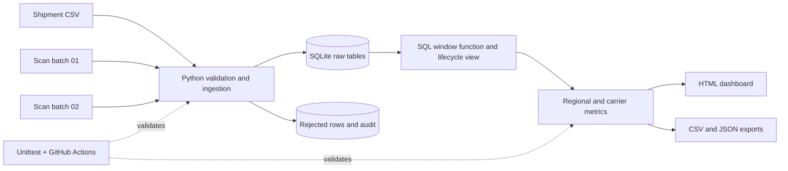

# System design

## Flow

## Grain and keys

- `shipments`: one row per `parcel_id` (primary key).
- `scan_events`: one row per `event_id` (primary key). Many scans may belong to one parcel.
- `parcel_lifecycle` view: one row per parcel. It joins the shipment master to the latest event-time scan and the earliest successful delivery scan.
- `rejected_rows`: one row per invalid input-file row. The `(source_file, row_number, entity_type)` tuple avoids repeating the same error on retries.
- `ingestion_audit`: one row per file ingestion attempt.

## Decisions

**Event time over arrival time.** The sample includes scans delivered in a second file even when the scan happened before one already loaded. Reporting sorts by `event_time` instead of insertion sequence.

**Immutable event IDs.** An existing event ID with matching content is a harmless duplicate. The same ID with different content is rejected, not overwritten.

**Transactional batches.** A malformed input row is quarantined without blocking unrelated valid records. Missing files or invalid CSV columns stop the load, with the current file transaction rolled back.

**Delivered-only denominator.** An undelivered parcel is neither counted as an on-time nor late *delivery*. It is instead represented through open and overdue counts.

**Fixed demo date.** The sample references `2026-11-05T00:00:00Z` so the report does not silently change with every execution. Use `--as-of` to report a different cutoff.

## Boundaries

This is a batch prototype, not a live tracking service. It deliberately uses SQLite, small synthetic CSV files, and a single-process runner. The pipeline does not automatically delete historical rejects for rows removed entirely from source files, and does not reconcile all real-world return/undeliverable scan types. A production extension would add source-level watermarks, schema-versioning, orchestration, metrics alerts, and a larger database or warehouse.
